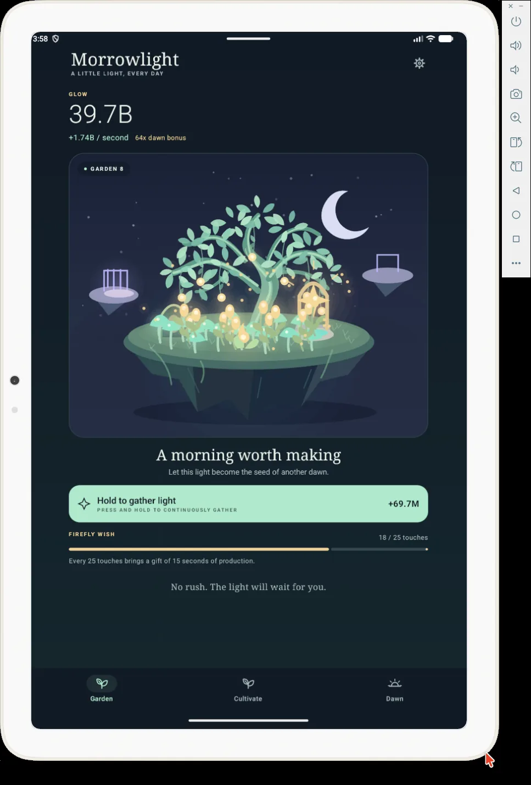

# Morrowlight

**A little light, every day.**

A native Android incremental game about bringing a floating garden back to life. Start with a single ember, gather Glow, and grow a home for the stars.

## Screenshot



## Play

- Tap the garden or **Hold to gather light**. Press and hold either surface to gather continuously after a brief delay.
- Spend your first 15 Glow on a **Glowcap** to start producing light automatically. Grow six cultivators; each colony doubles its output at 10, 25, 50, and 100 plants.
- In **Cultivate**, choose one, ten, or Max per purchase. Hold a plant's button to buy repeatedly; research upgrades remain single-action.
- Every 25 touches completes a **Firefly Wish**, adding 15 seconds of current production.
- Restore the dawn after earning one million Glow in a garden. Each **Dawn Seed** permanently adds 15% to production and base touch power; larger gardens earn more. Seeds, memories, lifetime statistics, and preferences survive the reset.
- Your garden keeps growing while you are away, for up to 8 hours initially and up to 24 hours with research.

## Look and feel

The garden uses a custom native Canvas scene, with three destinations: **Garden**, **Cultivate**, and **Dawn**. Reduced motion stops decorative animation, and haptics are optional.

## Build and install

Requires **JDK 21**, Android SDK platform **37**, and build tools **36.0.0**. Android 8.0 / API 26 is the minimum supported version. Set `ANDROID_HOME` or add `sdk.dir` to `local.properties`.

Build on Linux or macOS:

```sh
sh gradlew :core:test :app:testDebugUnitTest :app:assembleDebug :app:lintDebug
```

Build on Windows:

```powershell
.\gradlew.bat :core:test :app:testDebugUnitTest :app:assembleDebug :app:lintDebug
```

Install the debug APK on either platform:

```sh
adb install -r app/build/outputs/apk/debug/app-debug.apk
```

The standard Gradle Wrapper launchers use the checked-in `gradle/wrapper/gradle-wrapper.jar` to download Gradle **9.8.1** and verify its pinned distribution SHA-256. The Android GitHub Actions workflow tests, builds, and lints the app; its `Morrowlight-debug` artifact contains the debug APK. Release APKs are unsigned.

## Project notes

- `core`: dependency-free Kotlin game logic, saves, number formatting, and shared garden geometry.
- `app`: native Android UI, lifecycle integration, and app state.

Saves are local; Android's system backup may include them. Checkpoint reads and writes share one ordered queue, so reopening the Activity waits for progress queued by the previous instance before loading. The app has no network permission, ads, analytics, accounts, or in-app purchases.
